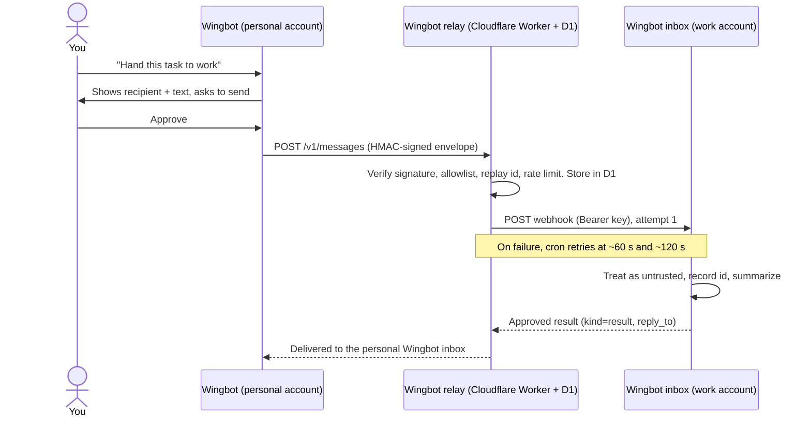

# Wingbot

> *The friend who introduces your bot to another bot.*

Wingbot lets two Grok Bot accounts (say, **personal** and **work**) hand tasks and results to each other while staying separate. Each account has one dedicated **Wingbot** bot with a **Wingbot inbox** webhook routine, and that inbox is the only way across. The relay is a small Cloudflare Worker that runs on the free tier and that you deploy to your own account.

- **Signed:** every request is HMAC-SHA256 signed with a per-pair secret. Unsigned requests get `401` and unknown paths get `404`.
- **Reliable:** messages are stored in D1. A once-a-minute cron retries failed deliveries (3 attempts total).
- **Safe by default:** replay protection, an allowlist, rate limits, an audit log, and a kill switch. Receiving bots treat payloads as untrusted and ask their owner before doing anything consequential.
- **Visible:** sends go through the Wingbot bot, so both sides of every exchange show up in chat.

## How it works



## Quickstart

```bash
git clone https://github.com/txchai/wingbot-relay.git wingbot && cd wingbot
npm install && npm run test:all
npx wrangler login                       # keep the terminal open; use a private window if you have several CF accounts
npx wrangler d1 create wingbot
cp wrangler.toml.example wrangler.toml   # fill in account_id, database_id, webhook URLs
npx wrangler d1 migrations apply wingbot --remote
mkdir -p ~/.wingbot && chmod 700 ~/.wingbot
node cli/wingbot-registry.mjs gen-secret --out ~/.wingbot/pair.secret
tr -d '\n' < ~/.wingbot/pair.secret | npx wrangler secret put HMAC_PAIR_PERSONAL_WORK
# ...admin secret, webhook keys, bots and routines: see docs/SETUP.md
npx wrangler deploy
node cli/wingbot-send.mjs --to work:wingbot --task "PING"
```

**Full step-by-step guide: [docs/SETUP.md](docs/SETUP.md)**

## Sending

```bash
node cli/wingbot-send.mjs --to <bot-id> --task "text" [--kind task|result] [--reply-to <id>] [--context-json '{}'] [--dry-run]
node cli/wingbot-send.mjs --admin pause|resume [--bot <bot-id>]   # with WINGBOT_SECRET_FILE pointing at the admin secret
```

Settings come from the environment or from `~/.wingbot/env` (`WINGBOT_URL`, `WINGBOT_BOT`, `WINGBOT_SECRET_FILE`). Exit codes: `0` accepted, `2` 4xx, `3` 5xx/network, `64` usage/config (nothing sent). A Bash signer, `cli/wingbot-send.sh`, is also included.

## Development

```bash
npm run test:all     # vitest (Workers runtime + local D1) and CLI tests; uses wrangler.test.toml
npm run typecheck
npm run dev          # local worker; copy .dev.vars.example to .dev.vars first
```

## Docs

- [docs/SETUP.md](docs/SETUP.md): full setup, verification, kill switch, rotation, troubleshooting
- [docs/PROTOCOL.md](docs/PROTOCOL.md): wire protocol, signing, status codes
- [docs/ROUTINE_PROMPT.md](docs/ROUTINE_PROMPT.md): receiver and sender prompts
- [docs/ADD_A_BOT_PAIR.md](docs/ADD_A_BOT_PAIR.md): more bots and pairs
- [docs/MARKETPLACE.md](docs/MARKETPLACE.md): listing and a paste-ready bot description
- [templates/wingbot-bot/](templates/wingbot-bot/): shareable Wingbot bot template (persona + inbox routine)
- [SPEC.md](SPEC.md), [CONTRACT.md](CONTRACT.md): design and frozen contract
- [SECURITY.md](SECURITY.md), [CONTRIBUTING.md](CONTRIBUTING.md)

## License

MIT. See [LICENSE](LICENSE).
